# Gestão de Ações

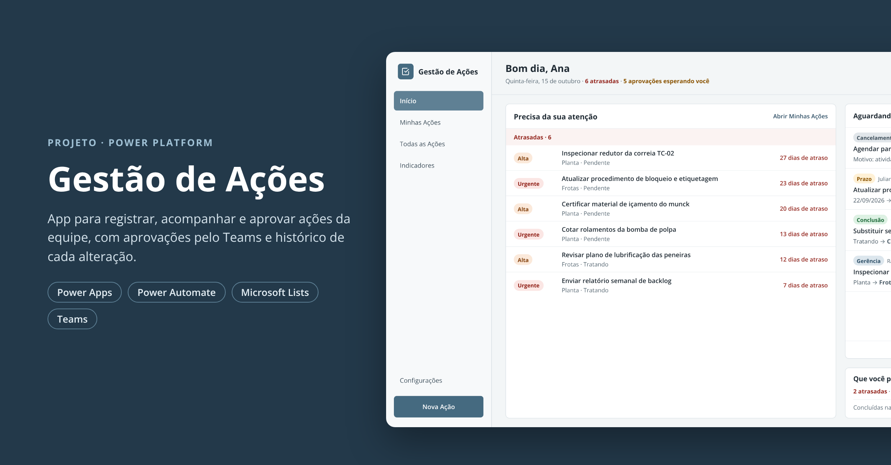

Aplicativo em **Power Apps** para registrar, acompanhar e aprovar as ações de uma equipe de manutenção. Ele substituiu uma agenda diária em planilha. Cada pendência agora tem um dono, um prazo, um status e um histórico, e as mudanças sensíveis passam por **aprovação pelo Microsoft Teams**.

> As telas e os dados deste repositório são **fictícios**. Nomes de pessoas, ações e números foram trocados para a publicação.

**Stack:** Power Apps (canvas) · Power Fx · Microsoft Lists / SharePoint · Power Automate · Cards adaptativos no Teams

---

## Sumário

- [O problema](#o-problema)
- [Funcionalidades](#funcionalidades)
- [Telas](#telas)
- [Arquitetura](#arquitetura)
- [Modelo de dados](#modelo-de-dados)
- [Fluxo de aprovação](#fluxo-de-aprovação)
- [Regras de permissão](#regras-de-permissão)
- [Decisões técnicas](#decisões-técnicas)
- [Estrutura do repositório](#estrutura-do-repositório)
- [Limitações e próximos passos](#limitações-e-próximos-passos)

---

## O problema

As ações da equipe (pendências de reunião, pedidos por e-mail, lembretes) ficavam numa agenda compartilhada. Isso causava três problemas:

- ninguém sabia com certeza **quem** era o dono de cada item nem **até quando**;
- prazos eram alterados sem registro, então não dava para saber se uma ação estava atrasada ou se tinha sido reprogramada;
- não havia visão consolidada: quantas ações estão abertas, atrasadas, por área ou por pessoa.

## Funcionalidades

- **Início "Meu dia"**: o que está atrasado para você, os pedidos esperando sua aprovação e o que você delegou a outras pessoas.
- **Minhas Ações em Kanban**: colunas Pendente → Tratando → Finalizadas, com ações rápidas (iniciar tratamento, concluir, pedir cancelamento).
- **Todas as Ações**: tabela com abas (em aberto, atrasadas, concluídas, canceladas), busca e filtros por prioridade, responsável e gerência.
- **Cadastro e edição** em três blocos (contexto da origem, tarefa e acompanhamento), com validações:
  - o prazo não pode ser anterior à data da demanda;
  - mudar o prazo exige justificativa;
  - concluir exige anexo quando a ação "requer evidência";
  - um item em atraso exige reprogramação.
- **Nova Rápida**: salva e mantém o contexto (gerência, origem, solicitante, responsáveis...) para cadastrar várias ações da mesma reunião em sequência.
- **Aprovação de mudanças críticas**: prazo, reprogramação, descrição, gerência, data da demanda, conclusão e cancelamento. A aprovação é feita pelo card no Teams **ou** pelo próprio app.
- **Histórico por ação**: linha do tempo de cada campo alterado, com a evolução do prazo (original → reprogramações).
- **Indicadores**: em aberto, atrasadas, concluídas, % no prazo, reprogramadas e tempo médio, com comparativo por gerência, origem, prioridade ou responsável e uma série mensal de criadas × concluídas.
- **Visibilidade pública ou privada** e **exclusão lógica** (a ação apagada some das telas, mas continua na lista).

## Telas

| Início | Minhas Ações |
|---|---|
| 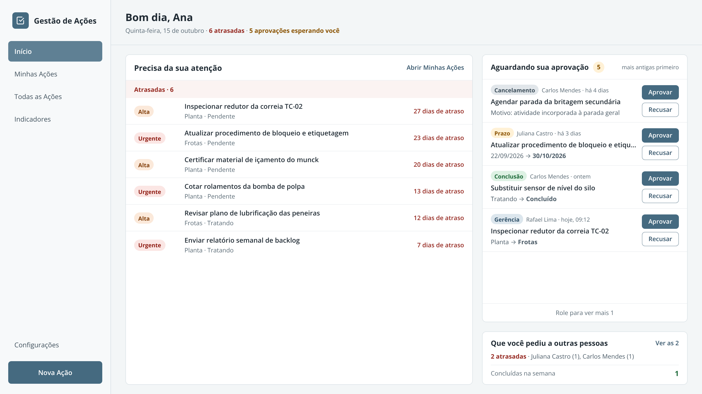 | 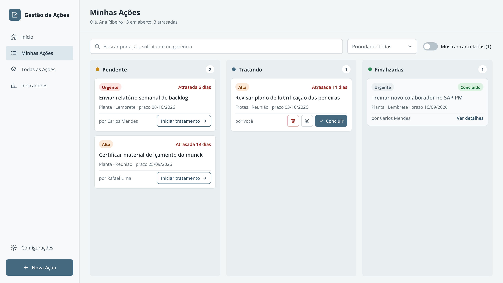 |

| Todas as Ações | Editar ação (permissões) |
|---|---|
| 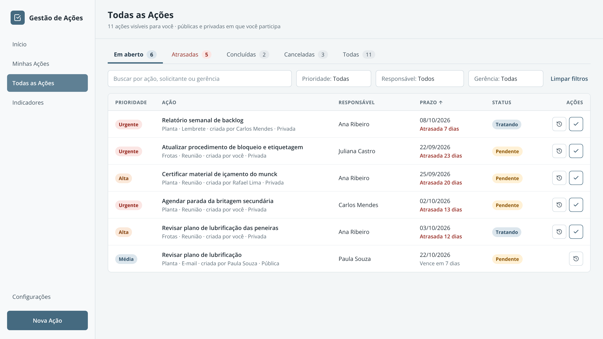 | 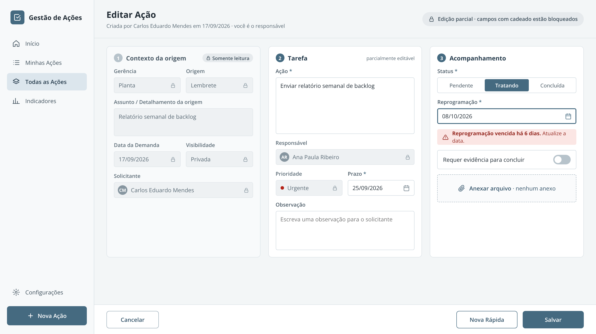 |

| Nova Ação Rápida | Indicadores |
|---|---|
| 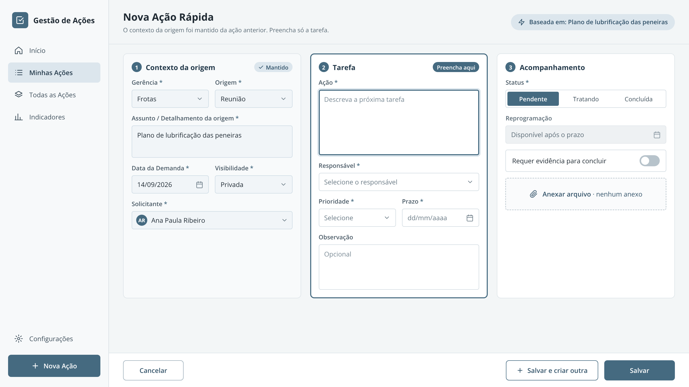 | 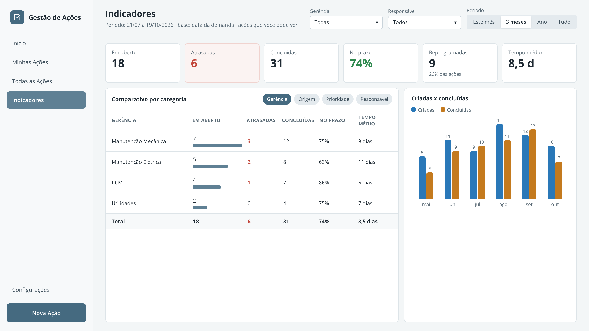 |

| Histórico da ação | Card de aprovação no Teams |
|---|---|
| 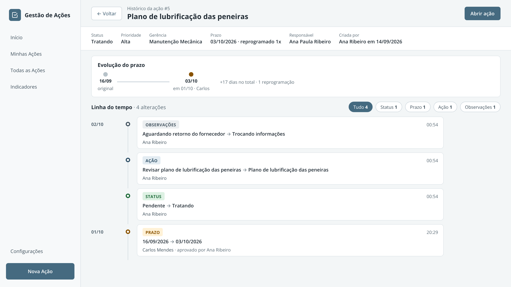 | 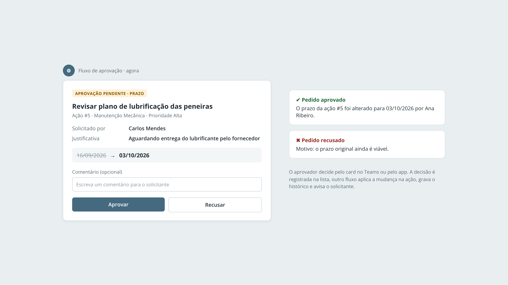 |

## Arquitetura

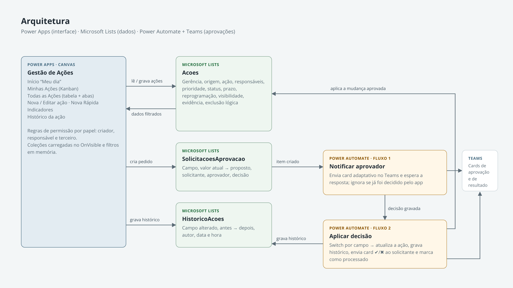

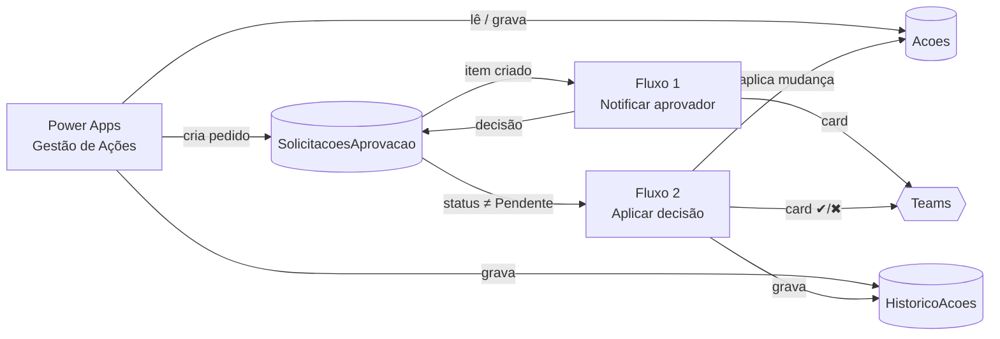

O app e o Teams **só registram a decisão** na lista de solicitações. Quem aplica a mudança na ação é sempre o fluxo 2, e isso evita que exista regra de negócio duplicada em dois lugares.

## Modelo de dados

Três listas do Microsoft Lists, mais uma lista de colaboradores para preencher os campos de pessoa.

**Acoes**

| Coluna | Tipo | Observação |
|---|---|---|
| Gerencia, Origem | Escolha | Contexto de onde a ação nasceu |
| DetalhamentoOrigem | Texto | Assunto/reunião de origem |
| Acao | Texto | O que precisa ser feito |
| Solicitante | Texto | Quem pediu |
| Responsavel | Pessoa (vários) | Pode ter mais de um dono |
| CriadoPor | Pessoa | Quem criou; é o aprovador das mudanças |
| Prioridade / PrioridadeOrdem | Escolha / Número | A ordem numérica permite ordenar sem delegação problemática |
| Status | Escolha | Pendente, Tratando, Concluído, Cancelado |
| DataDemanda, Prazo, Reprogramacao, Conclusao | Data | O atraso usa `Coalesce(Reprogramacao, Prazo)` |
| Visibilidade | Escolha | Pública ou Privada |
| RequerEvidencia | Sim/Não | Exige anexo para concluir |
| Excluida, ExcluidaEm | Sim/Não, Data | Exclusão lógica |

**SolicitacoesAprovacao**: AcaoID, CampoModificado, ValorAtual, ValorProposto, Justificativa, SolicitanteNome/Email, ResponsavelEmail (aprovador), StatusAprovacao (Pendente/Aprovado/Rejeitado), JustificativaAprovador, Processando.

**HistoricoAcoes**: AcaoID, CampoAlterado, ValorAnterior, ValorNovo, AlteradoPor, DataHora.

## Fluxo de aprovação

1. Alguém que **não é o criador** altera um campo crítico e salva.
2. O app salva na hora os campos livres (observações, detalhamento) e cria **uma solicitação por campo crítico alterado**. O usuário recebe na tela a mensagem *"Pedido enviado para aprovação de [criador]: Prazo, Ação…"*.
3. **Fluxo 1** dispara na criação da solicitação e envia um card adaptativo ao aprovador no Teams, que espera a resposta por até 7 dias.
4. O aprovador decide pelo **card** ou pela tela **Início**. Nos dois casos, só o `StatusAprovacao` da solicitação é atualizado.
5. **Fluxo 2** dispara quando a solicitação deixa de estar Pendente:
   - um `Switch` por `CampoModificado` atualiza só o campo certo da ação;
   - grava a linha no histórico com "aprovado por…";
   - envia o card ✔ APROVADA ou ✖ REJEITADA ao solicitante;
   - marca `Processando = Sim`.
6. Se o aprovador já decidiu pelo app e depois clica no card antigo, o fluxo 1 relê a solicitação, vê que ela já foi decidida e termina sem fazer nada.

As expressões usadas estão em [`power-automate/expressoes.md`](power-automate/expressoes.md).

## Regras de permissão

| Papel | O que pode fazer |
|---|---|
| **Criador** | Editar tudo diretamente, sem aprovação |
| **Responsável** | Pedir alteração de Ação, Prazo, Reprogramação e Status; escrever observações; os campos de contexto ficam bloqueados; não pode desligar "requer evidência" |
| **Outras pessoas** | Ver ações públicas em modo leitura |

Cada controle do formulário calcula seu `DisplayMode` a partir de duas variáveis definidas ao abrir a tela:

```powerfx
UpdateContext({
    varCriador: IsBlank(itemEdicao) || Lower(User().Email) = Lower(itemEdicao.CriadoPor.Email),
    varResp:    !IsBlank(itemEdicao) && Lower(User().Email) in Lower(itemEdicao.Responsavel.Email)
})
```

## Decisões técnicas

- **Uma leitura por tela.** Cada tela faz `Refresh` + `ClearCollect` no `OnVisible`. Busca, abas e filtros rodam em memória sobre a coleção, então trocar de aba não faz nova chamada ao SharePoint.
- **Salvamento à prova de falha.** O `Patch` principal fica dentro de `IfError`. O histórico e as solicitações só são gravados se a ação foi salva, e o botão fica travado durante o envio para evitar duplo clique.
- **Gravação em lote.** As linhas de histórico e de solicitações são montadas numa tabela, filtradas pelo que mudou e enviadas num único `Collect`.
- **Fluxo idempotente.** A condição do gatilho do fluxo 2 ignora itens já processados. Isso evita o loop que surgiria quando o próprio fluxo atualiza a solicitação.
- **Exclusão lógica.** Apagar marca `Excluida = true`. Nada se perde, e os indicadores não contam ações apagadas.
- **Datas trafegam como `dd/mm/aaaa`** na solicitação, para o card ficar legível, e são convertidas para ISO no fluxo antes de gravar.

O código Power Fx dos principais botões e telas está em [`power-fx/`](power-fx/).

## Estrutura do repositório

```
├── README.md
├── *.png                 # capturas de tela (dados fictícios) e diagrama
├── power-fx/             # fórmulas dos botões e do OnVisible das telas
│   ├── salvar-acao.fx
│   ├── nova-acao-rapida.fx
│   ├── historico-onvisible.fx
│   └── indicadores-onvisible.fx
└── power-automate/
    └── expressoes.md     # condição do gatilho e expressões dos fluxos
```

## Limitações e próximos passos

- **A visibilidade privada é aplicada pelo app.** Para proteger de verdade quem acessa a lista diretamente, o próximo passo é um fluxo que quebra a herança de permissão dos itens privados e libera acesso só ao criador e aos responsáveis.
- Mover as listas para um **site SharePoint da equipe**, com coproprietários do app e dos fluxos.
- Fluxo agendado para limpar definitivamente ações excluídas há mais tempo.
- Lembrete automático de ações perto do vencimento.

---

Desenvolvido por **Schaide Nunes**.
